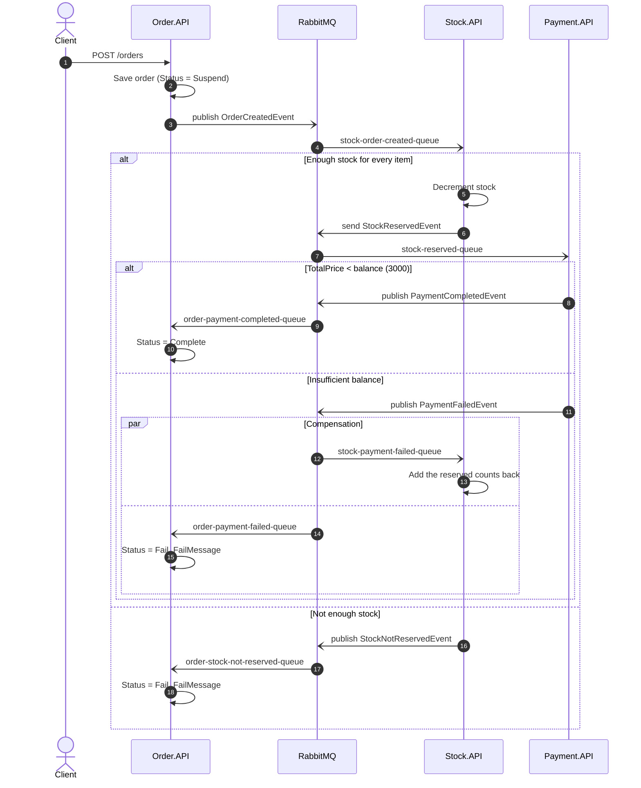
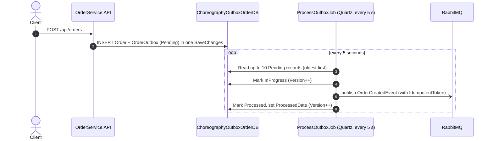

# Distributed Transactions with Saga Choreography

A .NET 8 sample of an event-driven, choreography-based saga across Order, Stock and Payment microservices, plus a separate transactional-outbox example (MassTransit, RabbitMQ, EF Core, SQL Server, Quartz.NET).


## Overview

Creating an order spans three services that each own their data, so there is no single ACID transaction to rely on. A **saga** splits the work into local transactions, and each service undoes its own work (a **compensating transaction**) when a later step fails.

This repository uses **choreography**. There is no central coordinator. Each service reacts to the events it is interested in and emits new events, and the overall workflow emerges from those reactions.

The repository contains two independent parts:

1. **Choreography saga** (`Order.API`, `Stock.API`, `Payment.API`, `Shared`): the order, stock and payment flow with compensation.
2. **Transactional outbox** (`src/services/Order/*`): a separate, layered Order service (Domain / Application / Persistence / API with MediatR). It writes the order and an outbox record in the same database transaction, and a Quartz.NET job (`ProcessOutboxJob`) publishes pending outbox records to RabbitMQ. It is not wired into the saga above.

## Architecture

### Choreography saga

| Service | Database | Consumes | Emits |
|---|---|---|---|
| `Order.API` | `ChoreographyOrderDB` | `PaymentCompletedEvent`, `PaymentFailedEvent`, `StockNotReservedEvent` | `OrderCreatedEvent` (publish) |
| `Stock.API` | `ChoreographyStockDB` | `OrderCreatedEvent`, `PaymentFailedEvent` | `StockReservedEvent` (send to `stock-reserved-queue`), `StockNotReservedEvent` (publish) |
| `Payment.API` | none | `StockReservedEvent` | `PaymentCompletedEvent` / `PaymentFailedEvent` (publish) |

Queue names are defined in `src/services/Shared/Constants/RabbitMQSettingsConst.cs`.



### Transactional outbox



Writing the business row and the outbox row in one local transaction guarantees an event is recorded **if and only if** the order is saved. The job then delivers it **at least once**, so consumers should deduplicate using `IdempotentToken`.

## Tech stack

- .NET 8, ASP.NET Core minimal APIs, Worker Service
- MassTransit 8.2.5 on RabbitMQ
- Entity Framework Core 8 with SQL Server (migrations included)
- MediatR 12 (outbox Order service)
- Quartz.NET 3.13 (outbox publisher job)
- Swagger / Swashbuckle (Development environment)

## Project structure

```text
DistributedTransactionSagaChoreography.sln
docker-compose.yml                         # RabbitMQ + SQL Server for local development
src/services/
├── Order.API/                             # Choreography: order service
│   ├── Consumers/                         # PaymentCompleted, PaymentFailed, StockNotReserved
│   ├── Contexts/, Entities/, Enums/, Migrations/, Models/
│   ├── Services/IOrderService.cs          # Saves order, publishes OrderCreatedEvent
│   └── Program.cs                         # POST /orders
├── Stock.API/                             # Choreography: stock service
│   ├── Consumers/                         # OrderCreated (reserve), PaymentFailed (compensate)
│   └── Contexts/, Entities/, Migrations/
├── Payment.API/                           # Choreography: simulated payment
│   └── Consumers/StockReservedEventConsumer.cs
├── Shared/                                # Choreography: events, messages, queue names
└── Order/                                 # Transactional outbox sample
    ├── Core/OrderService.Domain/          # Order, OrderOutbox, OrderInbox entities
    ├── Core/OrderService.Application/     # MediatR CreateOrder command, repository interfaces
    ├── Infrastructure/OrderService.Persistence/  # EF Core context, repositories, migrations
    ├── Presentation/OrderService.API/     # POST /api/orders
    ├── Jobs/ProcessOutboxJob/             # Quartz job that publishes outbox records
    └── Shared/                            # OrderCreatedEvent for the outbox sample
```

## Getting started

### Prerequisites

- [.NET 8 SDK](https://dotnet.microsoft.com/download) or newer
- Docker

### 1. Start the infrastructure

```bash
docker compose up -d
```

| Component | Address | Credentials |
|---|---|---|
| RabbitMQ (AMQP) | `localhost:5672` | `guest` / `guest` |
| RabbitMQ management UI | http://localhost:15672 | `guest` / `guest` |
| SQL Server | `localhost,1433` | `sa` / `Your_password123` |

These are **local development defaults only**. They match each service's `appsettings.json`, and you can override them with environment variables such as `ConnectionStrings__ConnectionString`.

> The SQL Server image is `linux/amd64`. On Apple Silicon it runs through Docker Desktop's Rosetta emulation.

### 2. Run the choreography saga

The APIs apply their EF Core migrations on startup. `Stock.API` also seeds products `1` = 200, `2` = 100, `3` = 50 and `4` = 10 when the table is empty.

```bash
dotnet run --project src/services/Stock.API   --launch-profile http   # http://localhost:5183
dotnet run --project src/services/Payment.API --launch-profile http   # http://localhost:5213
dotnet run --project src/services/Order.API   --launch-profile http   # http://localhost:5106/swagger
```

**Happy path.** The total is 200, which is below the simulated balance of 3000:

```bash
curl -X POST http://localhost:5106/orders -H "Content-Type: application/json" -d '{
  "buyerId": "1",
  "orderItems": [ { "productId": 1, "count": 2, "price": 100 } ],
  "payment": { "cardName": "John Doe", "cardNumber": "4111111111111111", "expiration": "12/30", "cvv": "123", "totalPrice": 200 },
  "address": { "line": "Main St 1", "province": "Istanbul", "district": "Besiktas" }
}'
```

The result is `Orders.Status = 1` (Complete), and stock for product 1 drops by 2.

- **Payment failure with compensation.** Order 10 units of product `2` at price `500`. The total is 5000, so payment fails, the order becomes `Status = 2` (Fail, `"not enough balance"`) and product 2's stock is restored.
- **Stock failure.** Order 50 units of product `4`. The order becomes `Status = 2` (Fail, `"Not enough stock"`).

All three requests are in `src/services/Order.API/Order.API.http`. `buyerId` must be a numeric string. The endpoint returns `200 OK` right after the order is stored, and the final status is set asynchronously.

### 3. Run the outbox sample (optional)

```bash
dotnet run --project src/services/Order/Presentation/OrderService.API --launch-profile http   # http://localhost:5107/swagger
dotnet run --project src/services/Order/Jobs/ProcessOutboxJob
```

```bash
curl -X POST http://localhost:5107/api/orders -H "Content-Type: application/json" \
  -d '{ "quantity": 3, "description": "outbox demo" }'
```

Within about 5 seconds the record in `ChoreographyOutboxOrderDB.dbo.OrderOutboxes` moves to `Status = 2` (Processed), and an `OrderService.Shared.Events.OrderCreatedEvent` is published to RabbitMQ. No service in this repository consumes it.

## Design notes and trade-offs

- **Choreography vs. orchestration.** There is no single point of control and services stay loosely coupled. The trade-off is that the workflow is implicit, spread across consumers, and harder to trace or change than a central state machine. For the orchestration version of the same domain, see [SagaOrchestration](https://github.com/gokhanertogan/SagaOrchestration).
- **Publish vs. send.** Most events are published, so any number of services can subscribe. `PaymentFailedEvent` fans out to both Order and Stock. `StockReservedEvent` is sent point-to-point to the payment queue.
- **Compensation is local.** Stock releases its own reservation when it sees `PaymentFailedEvent`. No service tells another service how to undo its work.
- **Outbox.** The order and its outbox record are committed atomically. The job uses a `Status` / `Version` / `ProcessedBy` progression and an in-process busy flag (`OrderSingletonDatabase`) so that overlapping Quartz triggers don't process the same batch twice.

## Known limitations

This is a learning sample, not production code:

- **No outbox in the saga services.** `Order.API` saves the order and then publishes in a separate step, so a failed publish leaves the order in `Suspend`.
- **No idempotency in consumers.** A redelivered `PaymentFailedEvent` would release stock twice.
- **Stock check and decrement aren't atomic**, so concurrent orders can oversell.
- **Payment is simulated** with a fixed balance of 3000. `PaymentRequestModel.TotalPrice` in the request is ignored, and the total is computed from the items.
- **Outbox `Version` isn't an EF Core concurrency token.** The busy flag only protects a single job instance, so running several instances could publish a record twice.
- **Errors in the outbox job are swallowed.** A record that fails to publish stays `InProgress` and is not retried.
- `OrderInbox` and its repository exist, but the inbox side isn't implemented: it isn't mapped in the `DbContext` and nothing uses it.
- No authentication, validation, health checks or automated tests.

## License

This project is licensed under the [MIT License](LICENSE).
